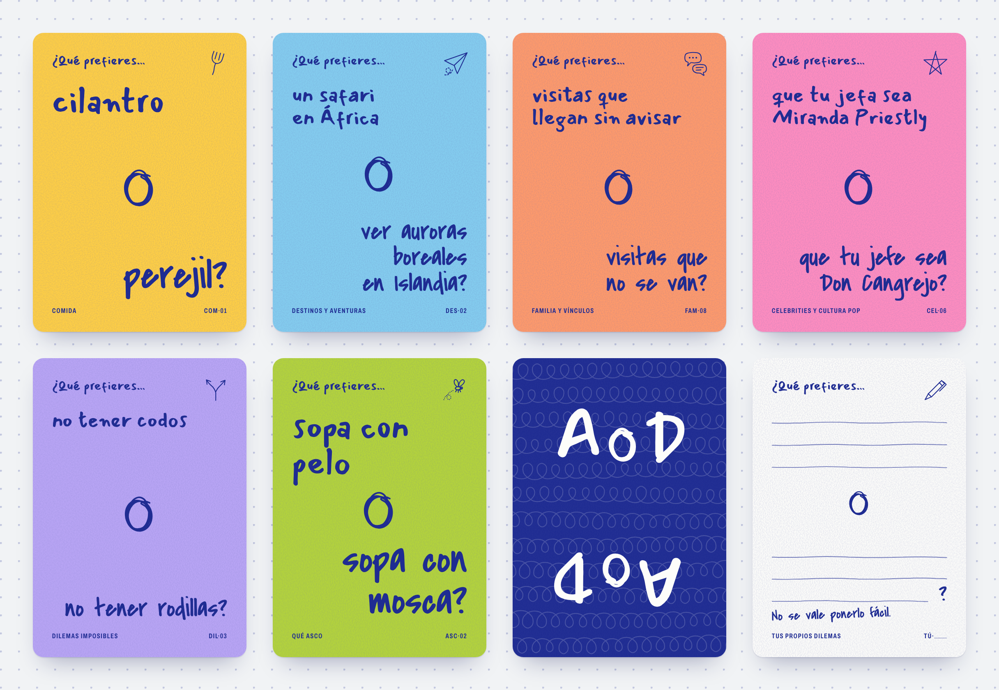
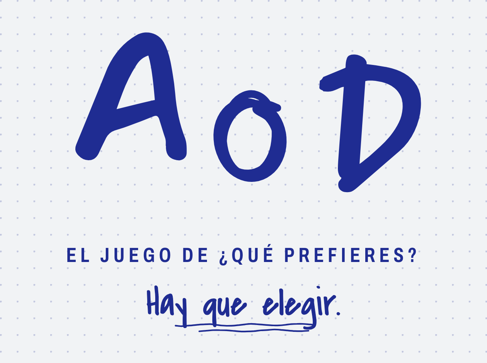
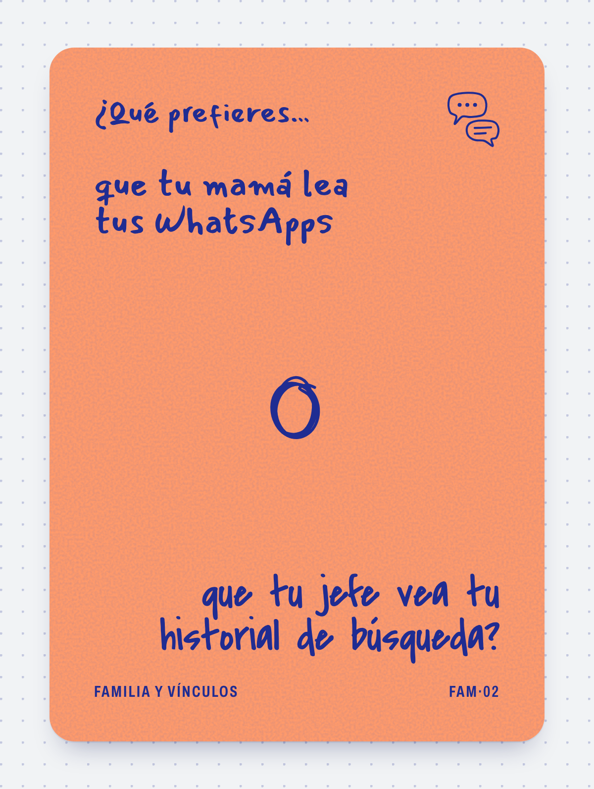

# A o D · Paquete completo para retomar el proyecto

Este documento junta **todo** lo necesario para entender, revisar o modificar
el juego sin acceso a nada más. Lo genera `node scripts/paquete-chatgpt.mjs` a
partir de los archivos del repositorio; si algo no coincide, manda el
repositorio.

## Dónde está cada cosa

- **Juego publicado (se puede abrir y jugar):** https://csaugusto.github.io/a-o-d/
- **Repositorio (público):** https://github.com/csaugusto/a-o-d
- **Archivos crudos legibles** (por si puedes abrir enlaces):
  `https://raw.githubusercontent.com/csaugusto/a-o-d/main/<ruta>`, por ejemplo
  `.../main/js/cartas.js` o `.../main/docs/img/cartas.png`.
- **Si recibiste este documento dentro de un zip:** junto a él vienen las
  imágenes (`img/`) y el código completo del juego (`codigo/`).

## Imágenes de referencia

- `img/cartas.png`: seis frentes (uno por categoría), el reverso y la carta en
  blanco.
- `img/logotipo.png`: logotipo completo con descriptor y lema.
- `img/carta-ejemplo.png`: una carta en grande.
- `img/juego-pantallas.png`: seis pantallas del juego en el teléfono (inicio,
  carta, modo prueba, resultados, hoja «Mazo», hoja «Tus dilemas»).
- `img/juego-*.png`: cada pantalla por separado, a 390 × 844 px (× 2).
- `img/direccion-*.png`: las tres direcciones visuales que se exploraron antes
  de elegir «Sobremesa a mano» (la elegida es `direccion-sobremesa.png`; su
  logotipo todavía decía «Cilantro o Perejil», el nombre anterior).

## Cómo devolver cambios para que se apliquen sin errores

**Cartas.** Las cartas viven solo en `js/cartas.js`. Para proponer cambios usa
esta forma, una línea por carta:

```
CAMBIAR  COM-05 | opción 1 | opción 2
AGREGAR  COM    | opción 1 | opción 2
QUITAR   DIL-17
APROBAR  FAM-02, FAM-08, CEL-03
```

Reglas: cada opción debe entenderse sola, en minúscula salvo nombres propios,
sin punto final ni signos de interrogación (la carta los pone), máximo 60
caracteres. Los códigos no se reutilizan: una carta nueva toma el siguiente
número libre de su categoría. El estado puede ser `ejemplo` (escrita por la
pareja), `borrador` (propuesta) o `aprobada`.

**Código.** El juego es HTML, CSS y JavaScript a mano, sin compilación ni
dependencias. Para cambios de código devuelve el archivo completo o un diff
claro, indicando la ruta. Respeta: nada de emojis en ningún archivo; nada de
`alert`, `confirm` ni `prompt`; el nombre del juego solo se escribe en
`js/cartas.js`; las medidas internas de la carta en `cqw`.

**Diseño.** Para cambios visuales describe qué cambiar en términos de los
tokens de la sección de identidad (por ejemplo «el papel de Familia más
claro») o devuelve el CSS concreto.

## Estructura del código

| Archivo | Qué hace |
| --- | --- |
| `index.html` | La pantalla del juego y sus hojas (Mazo, Tus dilemas, Cómo se juega, Resultados de la prueba) |
| `js/cartas.js` | **Única fuente de las cartas** y del nombre, descriptor, lema y edición (`window.MAZO`) |
| `js/carta.js` | Dibuja cada carta (`window.Carta`: frente, propia, enBlanco, reverso, reglas, portada, logotipo) |
| `js/app.js` | La lógica del juego: barajar, avanzar, regresar, filtros, dilemas propios, modo prueba, guardado |
| `css/tokens.css` | Colores y tipografías (incluye tema claro y oscuro de la mesa) |
| `css/carta.css` | El diseño de la carta, medido en `cqw` para escalar igual en pantalla e imprenta |
| `css/app.css` | El diseño de la pantalla alrededor de la carta |
| `imprimir/`, `scripts/exportar.mjs` | Archivos de impresión (en pausa) |
| `.github/workflows/publicar.yml` | Publica el juego en GitHub Pages con cada cambio en `main` |

## Estado y siguientes pasos

- Hecho: nombre, identidad visual, sistema de cartas, juego digital publicado,
  borrador de 110 cartas, archivos de impresión.
- Siguiente: jugarlo en el teléfono con el modo prueba, depurar las cartas,
  verificar el nombre «A o D» (marca, dominio, redes) y después retomar la
  impresión.
- Preguntas abiertas: qué significa «A o D» para la pareja (para el texto de la
  caja), qué cartas del borrador se quedan y en qué país se imprimiría.

---

# Anexo · Esencia del proyecto (escrita por la pareja)

_Fuente: `docs/esencia.md`_

## ¿QUÉ PREFIERES?

### Esencia del proyecto

Un juego de cartas para jugar con tu pareja, amigos o familia, inspirado en un juego que ya jugamos espontáneamente: hacernos preguntas de **«¿Qué prefieres?»** sobre cualquier cosa.

La idea nació después de comprar un juego de cartas para parejas en Islandia. Nos gustó como punto de partida, pero queríamos algo más nuestro: **menos conversación guiada y más decisiones tontas, inesperadas, difíciles, hipotéticas y a veces asquerosas**.

No queremos otro juego de cartas que parezca terapia de pareja. Queremos uno que puedas sacar en una sobremesa, en un viaje, en una cena o simplemente porque sí; que empiece con «¿cilantro o perejil?» y termine con alguien defendiendo por qué preferiría oler unos pies sudados antes que sacar cerilla de un oído.

**La esencia:** descubrir hasta dónde llegan nuestras preferencias y reírnos de lo cuestionables que pueden ser nuestras decisiones.

### Personalidad y tono

- **Espontáneo y muy sencillo.** Las preguntas suenan como las que nos haríamos entre nosotros, no como las que escribiría una marca intentando ser graciosa.
- **Divertido antes que profundo.** Puede provocar conversaciones interesantes, pero esa no es la obligación.
- **Absurdamente cotidiano.** Hay espacio para decisiones mínimas como «¿cilantro o perejil?».
- **Hipotético y ridículo.** También caben dilemas imposibles y situaciones que probablemente nunca pasarán.
- **Un poquito irreverente y, a veces, asqueroso.** Sin ser vulgar solo por ser vulgar.
- **Impredecible.** Una carta puede ser inocente y la siguiente absolutamente desagradable. El contraste es parte de la gracia.
- **Para parejas y amigos, no exclusivamente romántico.** Debe funcionar en distintos grupos.

> **Regla editorial principal:** si la respuesta es demasiado fácil, la carta no entra.

Las mejores cartas presentan **dos opciones que se sienten igual de posibles o igual de terribles**. No todas tienen que ser ingeniosas: algunas deben ser ridículamente simples.

### Cómo se juega

1. Alguien toma una carta y lee la pregunta: **«¿Qué prefieres…?»**
2. Cada persona elige entre las dos opciones.
3. **No se vale responder «las dos» ni «ninguna». Hay que elegir.**
4. Explicar la elección **no es obligatorio**, pero los demás pueden preguntar «¿POR QUÉ?» y ahí empieza la discusión.
5. Se pasa a la siguiente carta.

**Sin puntos, sin ganadores y sin reglas complicadas.** La experiencia está en elegir, debatir y reírse.

### Distribución acordada · Edición 01

**120 cartas en total: 110 preguntas impresas + 10 cartas en blanco.**

| Categoría | Número de cartas | Qué incluye |
| --- | ---: | --- |
| **Comida** | 20 | Ingredientes, antojos, hábitos, combinaciones y polémicas culinarias. |
| **Destinos y aventuras** | 20 | Viajes, lugares, actividades, experiencias y situaciones de exploración. |
| **Familia y vínculos** | 20 | Familia, amistades, pareja y dilemas sociales; sin asumir que todos tienen la misma situación familiar. |
| **Celebrities y cultura pop** | 20 | Famosos, personajes, películas, encuentros y escenarios improbables. |
| **Dilemas imposibles** | 20 | Situaciones hipotéticas, absurdas, incómodas y elecciones difíciles. |
| **Qué asco** | 10 | Preguntas desagradables, memorables y divertidas. Son la sorpresa, no el centro de todo el juego. |
| **Tus propios dilemas · Cartas en blanco** | 10 | Espacio para escribir nuevas preguntas de «¿Qué prefieres?». |
| **Total** | **120** | **110 impresas + 10 en blanco** |

#### Por qué esta mezcla

Hay **20 cartas por cada una de las cinco categorías principales**, **10 asquerosas** para que aparezcan de forma inesperada y **10 en blanco** para que el juego crezca con las personas que lo juegan.

No se divide por niveles de dificultad ni intensidad. La sorpresa de la siguiente carta es parte del juego.

### Ejemplos que definen el tono

#### Comida

- ¿Qué prefieres, **cilantro o perejil**?
- ¿Qué prefieres, **no volver a comer queso o no volver a comer pan**?

#### Destinos y aventuras

- ¿Qué prefieres, **una tarde en la playa o un hike en la montaña**?
- ¿Qué prefieres, **un safari en África o ver auroras boreales en Islandia**?

#### Familia y vínculos

- ¿Qué prefieres, **cuidar a sobrinos de 5 años o a un bebé de meses**?
- ¿Qué prefieres, **que tu mamá lea tus WhatsApps o que tu jefe vea tu historial de búsqueda**?

#### Celebrities y cultura pop

- ¿Qué prefieres, **una cena con Jude Bellingham o con Keanu Reeves**?
- ¿Qué prefieres, **que Pedro Pascal sea tu vecino o que Keanu Reeves sea tu compañero de trabajo**?

#### Dilemas imposibles

- ¿Qué prefieres, **tener siempre los pies fríos o las manos sudadas**?
- ¿Qué prefieres, **tener hipo cada vez que te ríes o estornudar cada vez que alguien dice tu nombre**?

#### Qué asco

- ¿Qué prefieres, **oler los pies sudados de tu mejor amigx o sacarle la cerilla de los oídos**?

Estos son **ejemplos de referencia para el tono**, no una lista definitiva de cartas aprobadas.

### Cartas en blanco

Queremos incluir **10 cartas para que la gente invente sus propios «¿Qué prefieres?»**.

Formato sugerido del frente:

**¿Qué prefieres?**

**A:** __________________________________

**O**

**B:** __________________________________

*No se vale ponerlo fácil.*

La intención es que se mezclen con las otras cartas y se vuelvan parte del mazo. **Como propuesta de producción**, podrían tener el mismo reverso que las demás y un acabado apto para escribir. El diseño y material definitivos aún no están cerrados.

### Lo que NO queremos

- Un juego exclusivamente para parejas.
- Un cuestionario de terapia, introspección o «conexión profunda».
- Preguntas rebuscadas que suenen artificiales.
- Un juego que sea siempre asqueroso, siempre absurdo o siempre extremo.
- Respuestas obvias sin dilema real.
- Mecánicas con puntajes, competencias o reglas que estorben la conversación.

### Criterios para escribir nuevas cartas

Antes de aprobar cada pregunta, preguntarnos:

1. **¿Suena como algo que nosotros preguntaríamos de verdad?**
2. **¿Obliga a elegir?** ¿Ninguna opción es claramente superior?
3. **¿Se entiende al instante?**
4. **¿Da ganas de saber qué responderán los demás?**
5. **¿Aporta variedad al mazo?** ¿Tiene su propio giro sin repetir otras preguntas?
6. **¿Funciona con amigos y/o pareja en una situación cotidiana?**

### Estado del proyecto

#### Ya acordado

- Nombre/concepto de trabajo: **¿Qué prefieres?**
- Público: **parejas, amigos y grupos diversos**.
- Esencia: **preferencias cotidianas + situaciones hipotéticas absurdas + algunas asquerosas**.
- Tono: **natural, divertido, irreverente sin forzarlo**.
- Mecánica básica: **elegir una de dos opciones, sin puntos ni ganadores**.
- Categorías y distribución: **20 + 20 + 20 + 20 + 20 + 10 + 10 cartas en blanco**.
- Total de primera edición: **120 cartas**.

#### Por desarrollar

- Redactar, probar y seleccionar las **110 preguntas definitivas**.
- Empezar con **las 20 preguntas de Comida** para calibrar el estilo.
- Definir identidad visual, tamaño, papel, reversos, empaque y detalles de producción.
- Probar el mazo con parejas y grupos de amigos para detectar preguntas demasiado fáciles o repetitivas.

---

**En una frase:** un juego de decisiones absurdamente simples —y a veces absurdamente desagradables— que convierte cualquier sobremesa en una conversación impredecible.

---

# Anexo · Avance

_Fuente: `AVANCE.md`_

## Avance · A o D

Resumen para compartir. Fecha: 11 de noviembre de 2026.

### En una frase

El juego ya existe en digital: se juega desde el teléfono con un mazo borrador de
110 cartas. Falta probarlo con gente, depurar las cartas y verificar el nombre
antes de imprimir.

### 1. Nombre

**A o D** · *El juego de ¿Qué prefieres?* · Lema: *Hay que elegir.*

- Lo eligieron ustedes. Antes se investigaron 26 nombres y se verificaron 6
  finalistas; la recomendación era «Cilantro o Perejil», que no les convenció.
- «¿Qué prefieres?» queda como descriptor, no como nombre: ya existe un juego de
  cartas con ese título exacto (Juegos Sucios, España, 2025), además de libros,
  apps y un registro de Televisa.
- Pendiente: «A o D» no pasó por búsqueda de conflictos. Antes de imprimir un
  tiraje: búsqueda de marca en el IMPI (clases 28 y 41), juegos parecidos,
  dominio y redes.

Detalle: `docs/nombre.md`.

### 2. Identidad visual: «Sobremesa a mano»

Se maquetaron tres direcciones (carta partida en dos, sobremesa a mano,
formulario oficial absurdo) y eligieron **sobremesa a mano**:

- Todo parece escrito con plumón azul pluma sobre papeles de colores, uno por
  categoría: Maíz (Comida), Cielo (Destinos), Mamey (Familia), Chicle
  (Celebrities), Jacaranda (Dilemas), Pepinillo (Qué asco).
- Dos letras a mano: una para la primera opción y otra para la segunda, que
  remata la pregunta. Una «o» repasada al centro.
- Logotipo «A o D» a mano; el ícono es la «o».
- Reverso azul con bucles y «A o D» dos veces (una de cabeza): se lee igual si
  giras la carta y no revela la categoría.
- Carta en blanco con renglones y «No se vale ponerlo fácil.»

Detalle: `docs/identidad.md`. Imágenes para compartir: `docs/img/`.

### 3. El juego digital (listo)

Se juega en **https://csaugusto.github.io/a-o-d/** (o abriendo `index.html`). Pensado para el teléfono en una sobremesa:

- El mazo boca abajo; tocas y sale la primera carta. Tocar, deslizar o
  «Siguiente carta» para avanzar; «Anterior» para regresar.
- Mazo barajado sin repetir hasta que se acaba. Contador discreto («37 de
  110»). Sin puntos ni ganadores.
- **Mazo:** prender o apagar categorías.
- **Tus dilemas:** escribir cartas propias (las cartas en blanco en digital),
  con vista previa en la carta real. Se mezclan en el mazo y se pueden copiar
  como texto.
- **Modo prueba:** debajo de cada carta, «Se queda», «Muy fácil» o «Fuera».
  Luego «Resultados de la prueba» las agrupa y se pueden copiar para decidir qué
  cartas salen del mazo.
- Modo claro y oscuro; guarda el avance en el navegador.

Probado en navegador a tamaño de teléfono, tableta y escritorio, con 17
pruebas de lógica. No se ha probado con el dedo en un teléfono real.

### 4. Las cartas (borrador)

110 cartas en `js/cartas.js` (única fuente) y legibles en `docs/cartas.md`.
Incluyen sus ejemplos originales; las demás son **borradores** para que ustedes
decidan. Distribución: Comida 20, Destinos y aventuras 20, Familia y vínculos
20, Celebrities y cultura pop 20, Dilemas imposibles 20, Qué asco 10, más 10 en
blanco. Hay cartas de reserva por categoría.

Algunas para calibrar el tono:

- salsa verde **o** salsa roja
- 3 tacos perfectos **o** 10 tacos regulares
- un hotel increíble con playa fea **o** un hotel feo con playa increíble
- visitas que llegan sin avisar **o** visitas que no se van
- que tu jefa sea Miranda Priestly **o** que tu jefe sea Don Cangrejo
- no tener codos **o** no tener rodillas
- un trago de leche cortada **o** una mordida de pan con moho

### 5. Impresión (preparada, en pausa)

Los archivos ya existen y se regeneran con `node scripts/exportar.mjs`:
hojas de prueba casera (9 cartas por hoja, tamaño real) y PDF/PNG para imprenta
en tamaño poker (63.5 × 88.9 mm). Quedó en pausa por decisión de ustedes.
Detalle de proveedores y precios: `docs/impresion.md`.

### Lo que sigue

1. Jugarlo en el teléfono con el modo prueba encendido y marcar cartas.
2. Depurar las 110 cartas con esos resultados y escribir las que falten.
3. Verificar el nombre «A o D» (marca, dominio, redes).
4. Retomar la impresión: prueba casera y luego prototipo.

### Preguntas abiertas para ustedes

- ¿Qué significa «A o D» para ustedes? (ayuda a escribir el texto de la caja)
- ¿Qué cartas del borrador se quedan?
- ¿En qué país lo imprimirían, cuando toque?

---

# Anexo · Nombre

_Fuente: `docs/nombre.md`_

## Nombre

### Decisión (11 de noviembre de 2026)

| | |
| --- | --- |
| **Nombre** | **A o D** |
| **Descriptor** (siempre pegado al nombre) | El juego de ¿Qué prefieres? |
| **Lema** | Hay que elegir. |
| **Ediciones** | A o D · Edición 01 |

Lo eligieron ustedes después de ver la investigación de abajo; no les convenció
«Cilantro o Perejil». El nombre vive en un solo lugar (`js/cartas.js`), así que
cambiarlo después es editar una línea.

«A o D» no pasó por la verificación de conflictos que sí tuvieron los finalistas
de abajo. Antes de imprimir un tiraje o registrar la marca conviene revisar:

- [ ] Búsqueda de marca en el IMPI (clases 28 y 41) y, según dónde se venda,
      OEPM, CIPO y USPTO.
- [ ] Juegos con nombre parecido (BoardGameGeek, Amazon, Mercado Libre).
- [ ] Dominio y usuarios en redes. Al ser tan corto, conviene buscarlo junto con
      «juego» (por ejemplo «aodjuego»).

### Investigación previa

Lo que sigue es la investigación de nombres del 10 de noviembre de 2026, que
recomendaba «Cilantro o Perejil». Se conserva como referencia y como plan B.

### Por qué no «¿Qué prefieres?» como nombre

«¿Qué prefieres?» es el nombre del género, igual que «Would You Rather» en
inglés. Sirve perfecto como descriptor porque todo el mundo lo entiende al
instante, pero como marca tiene tres problemas comprobados en la investigación
del 10 de noviembre de 2026:

- Ya existe un juego de cartas con ese título exacto: **¿Qué prefieres?** de
  Juegos Sucios (España, 2025, 150 dilemas).
- El título está saturado en libros (Libros Cúpula, geoPlaneta Kids y varios
  autopublicados), en apps («Qué Prefieres: Juego de Elegir», «Qué Prefieres? El
  Juego», «Dilemmaly - Que Prefieres») y en webs de dilemas en línea.
- En México, Televisa tiene registros de «¿Qué prefieres? en Telehit».

Con ese nombre el juego sería imposible de encontrar en buscadores y tiendas, y
difícil de registrar.

### Por qué «Cilantro o Perejil»

- **El nombre ya es una carta.** Quien lo lee contesta sin querer y entiende la
  mecánica sin instructivo. Sale literal de la esencia del proyecto: el juego
  «empieza con ¿cilantro o perejil?».
- **Cumple la regla editorial.** Son dos opciones casi iguales; nadie tiene la
  respuesta obvia.
- **Es el finalista con menos choque real.** No apareció ningún juego de mesa o
  de cartas con ese nombre (BoardGameGeek, búsqueda web), ni una marca con ambas
  palabras en juegos o entretenimiento en la base consultada (TMview).
- **Da un sistema de ediciones propio.** Cada edición o expansión puede llevar
  su propio par «X o Y» tomado de una carta real: «Queso o Pan», «Playa o
  Montaña», «Pies o Cerilla». La colección se reconoce por la fórmula.
- **Da identidad visual.** La «o» entre dos opciones es la misma «o» que separa
  A y B en cada carta: puede ser el logotipo, el reverso y el ícono de la app.
- **Suena natural.** «¿Jugamos Cilantro o Perejil?» y se acorta solo a «el
  Cilantro».

Salió de forma independiente en dos de los tres ángulos de ideación.

#### Debilidades conocidas y cómo se atienden

| Debilidad | Cómo se atiende |
| --- | --- |
| Solo, suena a recetario o blog de cocina; no anticipa lo absurdo ni lo asqueroso. | El descriptor «El juego de ¿Qué prefieres?» va siempre junto al nombre. |
| La frase sola es una duda de cocina muy buscada. | El juego se busca como «Cilantro o Perejil juego»; dominio y usuarios con la palabra «juego». |
| Casi homónimo de la película mexicana «Cilantro y perejil» (1996). | La «o» es protagonista del logotipo; es otra categoría (cine). |
| Es el más largo de los finalistas (3 palabras). | El ícono y el reverso usan solo la «o». |
| En Perú, Panamá y Honduras se dice «culantro». | Se entiende igual; es un matiz, no un bloqueo. |
| @cilantrooperejil y @cilantro_o_perejil ya existen en Instagram. | Probar variantes con punto o con «juego». |

### Los seis finalistas

Cada finalista pasó por una verificación escéptica (buscar razones para no
usarlo). Los puntajes son una valoración de 0 a 10, no una medición.

| Nombre | Puntaje | Riesgo | A favor | En contra |
| --- | ---: | --- | --- | --- |
| **Cilantro o Perejil** | 7.5 | medio | El nombre ya es una carta; sin vecino comercial incómodo; sistema de ediciones. | Largo; suena a cocina sin descriptor; película casi homónima. |
| Híjole | 6.5 | medio | Una palabra, mucha cara de logotipo; es la reacción de quien no sabe qué escoger. | Ya existe Híjole! Tequila en los mismos mercados; muy regional; no explica la mecánica. |
| Porque Sí | 5.8 | medio | Responde al «¿POR QUÉ?»; sistema en dos tiempos (reverso y caja). | Es la frase que mata la discusión; ortografía resbalosa; varios libros con ese título. |
| Una de Dos | 5.5 | medio | Describe la mecánica; se entiende en todo el mundo hispano. | En tiendas queda pegado a UNO y DOS de Mattel; frase común y descriptiva. |
| Cuestionable | 5.0 | medio | Sale de la esencia («decisiones cuestionables»); tono seco. | Ya hay juegos y apps «Questionable» en inglés del mismo género; connotación negativa. |
| No Se Vale | 4.0 | **alto** | Sale de la regla; es lo que se grita en la mesa. | Existe la marca idéntica «NO SE VALE» en el IMPI que cubre naipes (registro 583102); estatus sin confirmar. |

**Plan B:** si la búsqueda formal sale mal para «Cilantro o Perejil», el
siguiente es «Híjole», revisando antes qué tiene registrado el tequila. «No Se
Vale» vuelve a la conversación solo si se confirma que el registro 583102 del
IMPI caducó (su ficha muestra fecha de terminación 25/06/2018) y no hay
solicitudes nuevas.

La frase «no se vale» puede quedarse dentro de las reglas y de las cartas en
blanco («No se vale ponerlo fácil»): ahí es lenguaje común, no marca.

### Otros nombres que se consideraron

De 26 candidatos: Verde o Roja, Pan Comido, Tibio, Cilantro o Cerilla, Con Piña,
Calcetín Mojado, Hipo, Pleito de Sobremesa, Pelo en la Sopa, Tin Marín, La Menos
Peor, Sí o Sí, Ni Modo, Explícate, Las Dos No, ¿O Qué?, Prefe, Pff, Ni las dos
ni ninguna.

### Lo que falta verificar antes de decidir en firme

Nada de esto está hecho. La investigación fue una búsqueda web, no un dictamen
legal, y en varias verificaciones se agotó el número de búsquedas disponibles.

- [ ] Búsqueda formal de marca para «Cilantro o Perejil» en clases 28 (juegos) y
      41 (entretenimiento): IMPI (México), y según dónde se venda, OEPM
      (España), CIPO (Canadá) y USPTO (EE. UU.). Lo consultado fue TMview, que
      no es un registro oficial.
- [ ] Amazon, Mercado Libre y TikTok: no se pudieron revisar.
- [ ] Usuario en redes: probar @cilantro.o.perejil, @cilantrooperejil.juego y
      una variante corta.
- [ ] Dominio: cilantrooperejil.com respondió «No match» en whois el 10 de
      noviembre de 2026; eso no garantiza disponibilidad. Confirmar en un
      registrador.

### Dónde encaja en el mercado

El mercado en español está partido en dos polos: humor negro y vulgar para
mayores de 18 (Decisiones de Mierda, Guatafac, HDP, Juegos Sucios) y conexión
profunda de pareja (SOMOS, SENTIRE, Why Don't We, We're Not Really Strangers).
El punto medio que describe la esencia (cotidiano, absurdo, a veces asqueroso,
para sobremesa con pareja, amigos o familia) está vacío.

Otras diferencias que la investigación encontró y que conviene cuidar:

- Casi todos los rivales con formato de juego agregan votos, puntos, ruleta o
  juez. «Elegir y discutir, sin puntos» casi no existe: es una virtud que se
  puede declarar en la caja.
- Ningún competidor en español mezcla lo mínimo cotidiano con lo absurdo en el
  mismo mazo.
- Un solo mazo para cualquier grupo; los demás se segmentan por edición
  (pareja, amigos, familia).
- Referencia de precio en México para un mazo comparable: entre $380 y $500 MXN
  (consultado el 10 de noviembre de 2026; puede cambiar).

---

# Anexo · Identidad visual

_Fuente: `docs/identidad.md`_

## Identidad visual

Manual corto de **A o D · El juego de ¿Qué prefieres?** Todos los valores salen
de `css/tokens.css`, `css/carta.css`, `js/carta.js` y `js/cartas.js`. Si cambias
algo en esos archivos, actualiza también este documento.



### Concepto: «Sobremesa a mano»

Una sola pluma azul que pasa de mano en mano. Una letra arranca la pregunta con
la opción A y otra letra la remata con la opción B, como cuando dos personas
inventan dilemas en la sobremesa. Cada categoría tiene su papel de color; la
tinta nunca cambia. Lo único de imprenta es el pie de la carta.

### Logotipo



El logotipo es el nombre escrito a mano: la «A» con la primera letra (Mansalva),
la «D» con la segunda (Covered By Your Grace) y, en medio, una «o» dibujada y
repasada varias veces. La «o» es la protagonista: es la misma que separa las dos
opciones en cada carta.

Hay tres versiones. Todas las dibuja `Carta.logotipo()` en `js/carta.js`; no
hay un archivo de imagen del logotipo.

| Versión | Qué lleva | Dónde se usa | Cómo se pide |
| --- | --- | --- | --- |
| **Marca** | A, «o» y D | Reverso, lugares chicos | `Carta.logotipo()` |
| **Completo** | Marca + descriptor + lema subrayado | Portada, cabecera de las páginas | `Carta.logotipo({ variante: "completo" })` |
| **Ícono** | Solo la «o», blanca sobre cuadro azul con esquinas redondeadas | Ícono de la app; se lee hasta en 16 px | `Carta.logotipo({ variante: "icono" })` |

Sobre fondo azul se usa la versión clara (letras color servilleta):
`Carta.logotipo({ claro: true })`.

#### Descriptor y lema

- **Descriptor:** «El juego de ¿Qué prefieres?». Va siempre junto al nombre,
  porque «A o D» solo no explica qué es (ver `docs/nombre.md`). Se escribe en
  Archivo, mayúsculas y con letras separadas.
- **Lema:** «Hay que elegir.», a mano y subrayado. Es opcional fuera del
  logotipo completo.
- **Edición:** «Edición 01». Aparece en el pie de la portada y de las reglas.

Los cuatro textos viven en `js/cartas.js` (`nombre`, `descriptor`, `lema` y
`edicion`).

### Paleta

Una tinta, un papel por categoría. El contraste es de la tinta sobre cada papel;
todos pasan el mínimo de lectura (4.5 : 1).

| Nombre | Hex | Papel en el juego | Contraste con la tinta |
| --- | --- | --- | ---: |
| Azul pluma (`--tinta`) | `#1F2C92` | Todo lo escrito y dibujado; fondo del reverso y del ícono | |
| Servilleta (`--servilleta`) | `#FDFDFA` | Carta en blanco, dilema propio, portada, reglas; letra sobre azul | 11.2 : 1 |
| Maíz (`--papel-comida`) | `#FFCF45` | Comida | 7.8 : 1 |
| Cielo (`--papel-destinos`) | `#84CDEF` | Destinos y aventuras | 6.5 : 1 |
| Mamey (`--papel-familia`) | `#FF9A6B` | Familia y vínculos | 5.5 : 1 |
| Chicle (`--papel-celebrities`) | `#FF8DC0` | Celebrities y cultura pop | 5.4 : 1 |
| Jacaranda (`--papel-dilemas`) | `#B9A5F5` | Dilemas imposibles | 5.3 : 1 |
| Pepinillo (`--papel-asco`) | `#B4D43B` | Qué asco | 6.8 : 1 |

#### La mesa

La mesa es el fondo de la aplicación y de las páginas. Es lo único que cambia
entre tema claro y oscuro; las cartas se ven igual en los dos.

| Token | Claro (mantel) | Oscuro (mantel de noche) | Para qué |
| --- | --- | --- | --- |
| `--mesa` | `#F1F3F5` | `#141838` | Fondo |
| `--mesa-texto` | `#1F2C92` | `#E8EAF8` | Texto sobre la mesa |
| `--mesa-tenue` | `#5A6297` | `#A3A9D6` | Texto secundario |
| `--mesa-linea` | `rgba(31, 44, 146, .22)` | `rgba(232, 234, 248, .2)` | Líneas y puntos de la cuadrícula |
| `--mesa-sombra` | `rgba(23, 30, 90, .38)` | `rgba(0, 0, 0, .6)` | Sombra de las cartas |

El tema sigue al sistema. Para forzarlo se pone `data-theme="light"` o
`data-theme="dark"` en la etiqueta `<html>`.

### Tipografías

Dos letras a mano y una de imprenta. Las tres son de Google Fonts con licencia
abierta (SIL Open Font License 1.1): se pueden usar, imprimir y vender en el
juego sin pagar.

| Familia | Papel | Dónde aparece | Enlace |
| --- | --- | --- | --- |
| **Mansalva** | Mano A: quien arranca | «¿Qué prefieres…», opción A, la «A» del logotipo, título y números de las reglas | <https://fonts.google.com/specimen/Mansalva> |
| **Covered By Your Grace** | Mano B: quien remata | Opción B con su «?», la «D» del logotipo, lema, texto de las reglas, «No se vale ponerlo fácil.» | <https://fonts.google.com/specimen/Covered+By+Your+Grace> |
| **Archivo** | Imprenta | Pie de la carta (categoría y código) y descriptor: mayúsculas, angosta (68 a 70 %), peso 650, letras separadas | <https://fonts.google.com/specimen/Archivo> |

Las páginas cargan las tres desde Google Fonts. Sin conexión, el navegador usa
las de respaldo definidas en `css/tokens.css` (Bradley Hand, Marker Felt, Arial
Narrow y similares), que se ven distintas.

### Anatomía de la carta

Tamaño poker, proporción 5 : 7. Todo se mide en porcentaje del ancho de la
carta, así que la misma carta sirve en pantalla y en imprenta.



#### Frente

De arriba abajo:

1. **Arranque:** «¿Qué prefieres…» en la mano A.
2. **Garabato** de la categoría, arriba a la derecha: tenedor (Comida), avión de
   papel (Destinos), globos de diálogo (Familia), estrella (Celebrities),
   camino que se divide (Dilemas), mosca (Qué asco).
3. **Opción A**, alineada a la izquierda, en la mano A.
4. **La «o»** dibujada, al centro.
5. **Opción B**, alineada a la derecha, en la mano B, con el «?» final.
6. **Pie** de imprenta: categoría a la izquierda y código a la derecha. El código
   de `js/cartas.js` (`COM-01`) se imprime con punto medio: `COM·01`.

#### Tamaños de letra

El programa elige uno de cuatro tamaños según lo largo del texto. No hay que
hacer nada a mano.

| Nivel | Cuándo | Letra | «o» |
| --- | --- | --- | --- |
| `t-corta` | La opción más larga tiene hasta 14 caracteres | La más grande | La más grande |
| `t-media` | La opción más larga tiene hasta 34 caracteres | Mediana | Grande |
| `t-larga` | Más de 34 caracteres | Chica | Mediana |
| `t-mini` | Solo si el texto no cabe en los otros (palabras muy largas, todo en mayúsculas) | La más chica | Chica |

Si el texto no cabe en el tamaño que le toca, el programa baja al siguiente. La
opción B va un poco más grande que la A (1.14 contra 0.95 veces el tamaño del
nivel). Máximo recomendado: 60 caracteres por opción.

#### Reverso

Igual para todas las cartas, para que no delate la categoría. Fondo azul pluma
con una trama de rizos y el logotipo dos veces en color servilleta: uno derecho
y otro girado, para que se lea igual desde los dos lados de la mesa. No lleva
marcos: si el corte se mueve, no se nota.

#### Carta en blanco

Es la misma carta, todavía sin tinta. Papel servilleta, garabato de pluma, tres
renglones por opción (6.6 mm entre renglones, cabe letra a mano de verdad), una
«o» más chica, la frase «No se vale ponerlo fácil.» y el pie «Tus propios
dilemas · TÚ·___» con espacio para numerarla.

#### Dilema propio

Un dilema escrito por ustedes en el juego digital se dibuja como un frente
normal, pero en papel servilleta, con el garabato de pluma y el pie «Dilema
propio · TÚ».

#### Portada y reglas

Son cartas extra (sobran 6 lugares al imprimir; ver `docs/impresion.md`).

- **Portada:** logotipo completo, seis papelitos con los colores de las
  categorías y el pie «Edición 01 · 110 dilemas». El número se cuenta solo a
  partir de `js/cartas.js`.
- **Reglas:** «Cómo se juega» en cinco pasos numerados con círculos a mano,
  «¿POR QUÉ?» encerrado en un óvalo y «Hay que elegir.» subrayado. Cierra con
  «Sin puntos, sin ganadores, sin reglas complicadas.» El texto está en
  `REGLAS`, dentro de `js/carta.js`.

Todas las piezas se ven juntas en `diseno/muestrario.html`, que además mide
cada carta y avisa si algo se desborda o se sale de la zona segura.

### Reglas de uso

**Sí**

- Toda la letra y los dibujos en azul pluma. En el reverso y en el ícono, al
  revés: servilleta sobre azul.
- Un papel por categoría, siempre el mismo.
- El descriptor junto al nombre cuando alguien ve el juego por primera vez (caja,
  portada, tienda, redes).
- Sobre la mesa oscura o sobre cualquier fondo azul, la versión clara del
  logotipo.
- Dejar que el programa elija el tamaño de letra.
- Revisar el muestrario después de cambiar cartas, colores o tipografías: debe
  decir «Desbordes: 0».

**No**

- No uses negro ni otro color para el texto de las cartas.
- No pongas texto con los colores de los papeles: no se lee.
- No cambies la «o» dibujada por una «o» de teclado.
- No estires, inclines ni recoloques las letras del logotipo.
- No agregues otras tipografías.
- No escribas el nombre del juego directamente en las páginas: tómalo de
  `window.MAZO.nombre`.
- No dibujes marcos ni líneas delgadas cerca del borde de la carta.
- No pongas nada importante fuera de la zona segura (5 mm del corte).

### Cómo cambiar el nombre del juego

Cambia una línea en `js/cartas.js`:

```js
nombre: "A o D",
```

Las cartas, el reverso, la portada y el logotipo lo toman de ahí. Si el nombre
nuevo tiene la forma «algo o algo» (por ejemplo «Cilantro o Perejil»), el
logotipo dibuja la «o» en medio; si no, escribe el nombre entero con la mano A.
En el mismo lugar están `descriptor`, `lema` y `edicion`.

Los documentos (`docs/` y `AVANCE.md`) mencionan el nombre en el texto; esos se
corrigen a mano.

### Cómo agregar una categoría

Ejemplo con una categoría nueva llamada «Trabajo» (`id: "trabajo"`).

1. **`js/cartas.js`:** agrega un bloque dentro de `categorias`, con `id` (en
   minúsculas, sin acentos ni espacios), `codigo` (tres letras, por ejemplo
   `TRA`), `nombre`, `descripcion`, la lista `cartas` (`TRA-01`, `TRA-02`…) y
   `banca` (puede ir vacía).
2. **`css/tokens.css`:** agrega su papel, por ejemplo
   `--papel-trabajo: #XXXXXX;`. Comprueba que la tinta `#1F2C92` tenga contraste
   de 4.5 : 1 o más sobre ese color (el más bajo hoy es 5.3 : 1).
3. **`css/carta.css`:** junto a las otras categorías, agrega
   `.carta--trabajo { --papel: var(--papel-trabajo); }`.
4. **`js/carta.js`:**
   - En `GARABATOS`, agrega `trabajo: "g-…"` con el garabato que le toca. Si es
     un dibujo nuevo, agrégalo como `<symbol id="g-…">` en `SIMBOLOS`. Sin
     garabato propio, la carta usa la pluma de las cartas en blanco.
   - La portada pinta un papelito por cada entrada de `GARABATOS` y toma su giro
     de la lista `giros` (hoy tiene seis). Agrega un giro más, por ejemplo
     `"-3deg"`.
5. Corre `node scripts/listar-cartas.mjs` para actualizar `docs/cartas.md`.
6. Abre `diseno/muestrario.html` y revisa que diga «Desbordes: 0».

### Relación con la impresión

Los detalles de formato, papel y proveedores están en `docs/impresion.md`. Lo que
toca al diseño:

- **Sangrado:** al imprimir, a la carta se le agrega la clase `carta--sangrado`.
  El papel crece 3.175 mm por lado y la parte escrita no se mueve. Las esquinas
  se dibujan rectas: las redondea la imprenta.
- **Zona segura:** todo lo escrito queda a 5 mm o más del corte. El muestrario
  lo comprueba carta por carta.
- **Ahorro de tinta** (para imprimir en casa): clase `carta--ahorro`. Fondo
  blanco sin grano de papel; el color de la categoría queda solo en una franja
  arriba, que se va al sangrado. El reverso pasa a logotipo azul sobre blanco con
  la trama apenas visible.
- Los archivos salen en RGB. Si un proveedor pide CMYK, hay que convertirlos y
  pedir una prueba de color (ver `docs/impresion.md`).

---

# Anexo · Mazo completo

_Fuente: `docs/cartas.md`_

## Cartas de A o D · Edición 01

> Este archivo se genera automáticamente desde `js/cartas.js`. No lo edites a mano:
> cambia las cartas en `js/cartas.js` y vuelve a correr `node scripts/listar-cartas.mjs`.

Cada carta completa la frase «¿Qué prefieres…?» con dos opciones.

Estados: **ejemplo** = escrita por ustedes en `docs/esencia.md`;
**borrador** = propuesta por revisar; **aprobada** = ya la probaron y se queda.

### Conteo

| Categoría | Código | Cartas | Estados | En reserva |
| --- | --- | ---: | --- | ---: |
| [Comida](#comida) | COM | 20 | 2 ejemplo, 18 borrador | 4 |
| [Destinos y aventuras](#destinos-y-aventuras) | DES | 20 | 2 ejemplo, 18 borrador | 6 |
| [Familia y vínculos](#familia-y-vínculos) | FAM | 20 | 2 ejemplo, 18 borrador | 4 |
| [Celebrities y cultura pop](#celebrities-y-cultura-pop) | CEL | 20 | 2 ejemplo, 18 borrador | 4 |
| [Dilemas imposibles](#dilemas-imposibles) | DIL | 20 | 2 ejemplo, 18 borrador | 5 |
| [Qué asco](#qué-asco) | ASC | 10 | 1 ejemplo, 9 borrador | 6 |
| Cartas en blanco | TÚ | 10 | | |
| **Total** | | **120** | 11 ejemplo, 99 borrador | **29** |

110 preguntas impresas + 10 cartas en blanco = 120 cartas.

### Comida

Ingredientes, antojos, hábitos, combinaciones y polémicas culinarias. Código COM · 20 cartas.

| Código | Opción 1 | Opción 2 | Estado |
| --- | --- | --- | --- |
| COM-01 | cilantro | perejil | ejemplo |
| COM-02 | no volver a comer queso | no volver a comer pan | ejemplo |
| COM-03 | salsa verde | salsa roja | borrador |
| COM-04 | pizza fría | pizza recalentada | borrador |
| COM-05 | 3 tacos perfectos | 10 tacos regulares | borrador |
| COM-06 | desayuno dulce | desayuno salado | borrador |
| COM-07 | cocinar todos los días | lavar los platos todos los días | borrador |
| COM-08 | carne casi cruda | carne bien cocida | borrador |
| COM-09 | decidir siempre tú dónde se come | no volver a decidir dónde se come | borrador |
| COM-10 | refresco sin gas | papas fritas aguadas | borrador |
| COM-11 | todo al centro para compartir | cada quien su plato y ni una probadita | borrador |
| COM-12 | fresas con crema | mango con chile | borrador |
| COM-13 | que toda tu comida pique de más | que tu comida no vuelva a picar nunca | borrador |
| COM-14 | quemarte la lengua en cada comida | morderte el cachete en cada comida | borrador |
| COM-15 | helado en cono | helado en vasito | borrador |
| COM-16 | quedarte con tantita hambre | acabar a punto de reventar | borrador |
| COM-17 | ponerle cátsup a todo | ponerle mayonesa a todo | borrador |
| COM-18 | comerte primero lo que más te gusta | dejar lo mejor del plato para el final | borrador |
| COM-19 | cenar siempre a las 6 de la tarde | cenar siempre a las 11 de la noche | borrador |
| COM-20 | un mesero que nunca aparece | un mesero que viene cada dos minutos | borrador |

#### Reserva · Comida (4)

Pasaron el filtro pero no están en el mazo. Sirven para reemplazar cartas flojas.

| # | Opción 1 | Opción 2 |
| ---: | --- | --- |
| 1 | arroz | frijoles |
| 2 | huevos estrellados | huevos revueltos |
| 3 | cocinar sin ajo | cocinar sin cebolla |
| 4 | comer con alguien que hace ruido al masticar | comer con alguien que sorbe todo lo que toma |

### Destinos y aventuras

Viajes, lugares, actividades, experiencias y situaciones de exploración. Código DES · 20 cartas.

| Código | Opción 1 | Opción 2 | Estado |
| --- | --- | --- | --- |
| DES-01 | una tarde en la playa | un hike en la montaña | ejemplo |
| DES-02 | un safari en África | ver auroras boreales en Islandia | ejemplo |
| DES-03 | ventanilla | pasillo | borrador |
| DES-04 | perder tu maleta el primer día | perder tu celular el último día | borrador |
| DES-05 | Japón | Italia | borrador |
| DES-06 | vuelos gratis de por vida | hoteles gratis de por vida | borrador |
| DES-07 | dormir en un hostal con 12 desconocidos | dormir en una casa de campaña bajo la lluvia | borrador |
| DES-08 | museos | mercados | borrador |
| DES-09 | ir junto a un bebé que llora todo el vuelo | ir junto a alguien que te platica todo el vuelo | borrador |
| DES-10 | viaje todo incluido | viaje de mochilero | borrador |
| DES-11 | un hotel increíble con playa fea | un hotel feo con playa increíble | borrador |
| DES-12 | paracaídas | bungee | borrador |
| DES-13 | viajar una semana sin internet | viajar una semana con la misma ropa | borrador |
| DES-14 | Disney | Las Vegas | borrador |
| DES-15 | conocer 10 países en un mes | vivir un mes en una sola ciudad | borrador |
| DES-16 | nadar donde puede haber tiburones | acampar donde puede haber osos | borrador |
| DES-17 | selva | desierto | borrador |
| DES-18 | pasar un día del viaje con diarrea | pasar todo el viaje con ampollas en los pies | borrador |
| DES-19 | salir de viaje a las 4 de la mañana | llegar al hotel a las 3 de la mañana | borrador |
| DES-20 | un viaje a la Luna | un viaje al fondo del mar | borrador |

#### Reserva · Destinos y aventuras (6)

Pasaron el filtro pero no están en el mazo. Sirven para reemplazar cartas flojas.

| # | Opción 1 | Opción 2 |
| ---: | --- | --- |
| 1 | una escala de 10 horas | tres escalas de 40 minutos |
| 2 | viajar con alguien que se queja de todo | viajar con alguien que siempre llega tarde |
| 3 | Navidad con nieve | Navidad en la playa |
| 4 | road trip | viaje en tren |
| 5 | alberca | mar |
| 6 | gran ciudad | pueblito |

### Familia y vínculos

Familia, amistades, pareja y dilemas sociales. Código FAM · 20 cartas.

| Código | Opción 1 | Opción 2 | Estado |
| --- | --- | --- | --- |
| FAM-01 | cuidar a sobrinos de 5 años | cuidar a un bebé de meses | ejemplo |
| FAM-02 | que tu mamá lea tus WhatsApps | que tu jefe vea tu historial de búsqueda | ejemplo |
| FAM-03 | llamada | nota de voz | borrador |
| FAM-04 | que tu familia elija tu próximo tatuaje | que tus amigos elijan tu próximo tatuaje | borrador |
| FAM-05 | vecino fiestero | vecino chismoso | borrador |
| FAM-06 | que todas las reuniones sean en tu casa | que ninguna reunión sea en tu casa | borrador |
| FAM-07 | Navidad | Año Nuevo | borrador |
| FAM-08 | visitas que llegan sin avisar | visitas que no se van | borrador |
| FAM-09 | mesa de niños | mesa de adultos | borrador |
| FAM-10 | toparte con tu ex en el súper y en pijama | toparte con tu ex en plena primera cita | borrador |
| FAM-11 | que cada quien pague lo suyo | dividir la cuenta parejo entre todos | borrador |
| FAM-12 | vivir a 5 minutos de tu familia | vivir a 5 horas de tu familia | borrador |
| FAM-13 | silencio incómodo | plática forzada | borrador |
| FAM-14 | dar el brindis frente a todos | abrir la pista de baile | borrador |
| FAM-15 | despedirte de uno por uno | irte sin decir adiós | borrador |
| FAM-16 | que te regalen algo hecho a mano | que te regalen dinero en un sobre | borrador |
| FAM-17 | llegar siempre media hora antes | llegar siempre media hora tarde | borrador |
| FAM-18 | dormir con alguien que ronca | dormir con alguien que te quita la cobija | borrador |
| FAM-19 | prestarle dinero a un amigo | pedirle prestado a un amigo | borrador |
| FAM-20 | una cena donde solo se habla de política | una cena donde solo se habla de dietas | borrador |

#### Reserva · Familia y vínculos (4)

Pasaron el filtro pero no están en el mazo. Sirven para reemplazar cartas flojas.

| # | Opción 1 | Opción 2 |
| ---: | --- | --- |
| 1 | un fin de semana con tus suegros | un fin de semana con toda tu oficina |
| 2 | que tu familia sepa cuánto ganas | que tu familia vea en qué gastas |
| 3 | negocio con amigos | negocio con familia |
| 4 | que te sorprendan con el regalo | que te pregunten qué quieres de regalo |

### Celebrities y cultura pop

Famosos, personajes, películas, encuentros y escenarios improbables. Código CEL · 20 cartas.

| Código | Opción 1 | Opción 2 | Estado |
| --- | --- | --- | --- |
| CEL-01 | una cena con Jude Bellingham | una cena con Keanu Reeves | ejemplo |
| CEL-02 | que Pedro Pascal sea tu vecino | que Keanu Reeves sea tu compañero de trabajo | ejemplo |
| CEL-03 | Friends | The Office | borrador |
| CEL-04 | cocinarle a Gordon Ramsay | bailar frente a Shakira | borrador |
| CEL-05 | Luis Miguel | Juan Gabriel | borrador |
| CEL-06 | que tu jefa sea Miranda Priestly | que tu jefe sea Don Cangrejo | borrador |
| CEL-07 | meter el gol que gana un Mundial | ganar un óscar | borrador |
| CEL-08 | Shrek | Toy Story | borrador |
| CEL-09 | participar en un reality dentro de una casa | participar en un reality en una isla desierta | borrador |
| CEL-10 | un karaoke con Chayanne | un karaoke con Ricky Martin | borrador |
| CEL-11 | película doblada | película subtitulada | borrador |
| CEL-12 | solo poder ver series que ya viste | solo poder ver series que no has visto | borrador |
| CEL-13 | ver en vivo a Queen con Freddie Mercury | ver en vivo a los Beatles | borrador |
| CEL-14 | Dragon Ball | Pokémon | borrador |
| CEL-15 | unas vacaciones con las Kardashian | unas vacaciones con la familia real británica | borrador |
| CEL-16 | adoptar a Baby Yoda | adoptar a Stitch | borrador |
| CEL-17 | tener un cameo en Los Simpson | tener un cameo en una película de Marvel | borrador |
| CEL-18 | tener los poderes de Spider-Man | tener a Alfred, el mayordomo de Batman | borrador |
| CEL-19 | un maratón de todo Harry Potter | un maratón de todo El Señor de los Anillos | borrador |
| CEL-20 | pasar un día en Jurassic Park | jugar una partida de Jumanji | borrador |

#### Reserva · Celebrities y cultura pop (4)

Pasaron el filtro pero no están en el mazo. Sirven para reemplazar cartas flojas.

| # | Opción 1 | Opción 2 |
| ---: | --- | --- |
| 1 | irte de viaje con Jack Sparrow | irte de viaje con Indiana Jones |
| 2 | que todo el mundo te conozca por un meme | que todo el mundo te conozca por una telenovela |
| 3 | Bad Bunny | Daddy Yankee |
| 4 | team Edward | team Jacob |

### Dilemas imposibles

Situaciones hipotéticas, absurdas, incómodas y elecciones difíciles. Código DIL · 20 cartas.

| Código | Opción 1 | Opción 2 | Estado |
| --- | --- | --- | --- |
| DIL-01 | tener siempre los pies fríos | tener siempre las manos sudadas | ejemplo |
| DIL-02 | tener hipo cada vez que te ríes | estornudar cada vez que alguien dice tu nombre | ejemplo |
| DIL-03 | no tener codos | no tener rodillas | borrador |
| DIL-04 | solo poder susurrar | solo poder gritar | borrador |
| DIL-05 | la misma canción pegada de por vida | una palabra en la punta de la lengua de por vida | borrador |
| DIL-06 | andar siempre con sueño | andar siempre con ganas de hacer pipí | borrador |
| DIL-07 | soltar la carcajada en cada funeral | ponerte a llorar en cada fiesta | borrador |
| DIL-08 | siempre en pijama | siempre de gala | borrador |
| DIL-09 | un mosquito en tu cuarto todas las noches | que llueva cada vez que sales de casa | borrador |
| DIL-10 | casa sin puertas | casa sin ventanas | borrador |
| DIL-11 | escribir siempre con faltas de ortografía | escribir siempre todo en mayúsculas | borrador |
| DIL-12 | no alcanzar nunca la repisa de arriba | pegarte siempre con el marco de la puerta | borrador |
| DIL-13 | traer siempre algo verde entre los dientes | traer siempre la bragueta abierta | borrador |
| DIL-14 | oler todo diez veces más fuerte | oír todo diez veces más fuerte | borrador |
| DIL-15 | 5 horas en un elevador atorado y lleno de gente | 5 horas a solas en un teleférico atorado | borrador |
| DIL-16 | nunca perder en piedra, papel o tijera | encestar siempre en el bote de basura | borrador |
| DIL-17 | no acordarte nunca del nombre de nadie | que nadie se acuerde nunca de tu nombre | borrador |
| DIL-18 | que un narrador de fútbol narre todo lo que haces | que se oigan risas grabadas cada vez que hablas | borrador |
| DIL-19 | no volver a verte en un espejo | no volver a salir en una foto | borrador |
| DIL-20 | bañarte siempre con agua helada | tomar siempre tus bebidas tibias | borrador |

#### Reserva · Dilemas imposibles (5)

Pasaron el filtro pero no están en el mazo. Sirven para reemplazar cartas flojas.

| # | Opción 1 | Opción 2 |
| ---: | --- | --- |
| 1 | tener en tu cuarto un mosquito que nunca se va | tener sobre tu cama una gotera que nunca para |
| 2 | que suene una trompeta cada vez que entras a un lugar | que te aplaudan cada vez que sales del baño |
| 3 | compartir casa con un fantasma chismoso | compartir casa con un loro que repite todo |
| 4 | siempre sin zapatos | siempre con casco |
| 5 | olfato de perro | oído de murciélago |

### Qué asco

Preguntas desagradables, memorables y divertidas. Son la sorpresa, no el centro. Código ASC · 10 cartas.

| Código | Opción 1 | Opción 2 | Estado |
| --- | --- | --- | --- |
| ASC-01 | oler los pies sudados de tu mejor amigx | sacarle la cerilla de los oídos | ejemplo |
| ASC-02 | sopa con pelo | sopa con mosca | borrador |
| ASC-03 | lamer el tubo del metro | lamer la suela de tu zapato | borrador |
| ASC-04 | limpiar vómito | destapar un baño | borrador |
| ASC-05 | que te caiga popó de paloma en la cabeza | que un perro te haga pipí en la pierna | borrador |
| ASC-06 | baño de gasolinera | baño de festival | borrador |
| ASC-07 | vivir con alguien que deja uñas cortadas en el sillón | vivir con alguien que usa tu cepillo de dientes | borrador |
| ASC-08 | pisar una babosa con el pie descalzo | pisar una cucaracha con el pie descalzo | borrador |
| ASC-09 | un trago de leche cortada | una mordida de pan con moho | borrador |
| ASC-10 | que te estornuden en la nuca | que te eructen en la cara | borrador |

#### Reserva · Qué asco (6)

Pasaron el filtro pero no están en el mazo. Sirven para reemplazar cartas flojas.

| # | Opción 1 | Opción 2 |
| ---: | --- | --- |
| 1 | agua de florero | agua de pecera |
| 2 | caldo con pellejo | leche con nata |
| 3 | ponerte tu ropa sudada del gym de ayer | secarte con una toalla que huele a humedad |
| 4 | que se te pegue un curita usado en la alberca | tragar agua de la alberca de los niños |
| 5 | lavar un tupper olvidado un mes en el refri | lavar a mano el bote de basura de la cocina |
| 6 | saludar de mano a quien salió del baño sin lavarse | saludar de mano a quien se acaba de sacar un moco |

---

# Anexo · Impresión (en pausa)

_Fuente: `docs/impresion.md`_

## Impresión

Todo lo que hay que saber para pasar del mazo digital a cartas físicas. Los
precios y especificaciones se consultaron el **10 de noviembre de 2026** en los
sitios de cada proveedor; cambian sin aviso y no incluyen envío, impuestos ni
aduana. Los totales por copia son cálculos a partir de esas tarifas.

### Formato decidido

| | |
| --- | --- |
| **Tamaño** | Poker, 63.5 × 88.9 mm (2.5 × 3.5 in), vertical |
| **Archivo con sangrado** | 69.85 × 95.25 mm (2.75 × 3.75 in) = 825 × 1125 px a 300 dpi |
| **Sangrado** | 3.175 mm (1/8 in) por lado |
| **Zona segura** | Texto a 5 mm o más de la línea de corte |
| **Esquinas** | Las redondea la imprenta (radio aproximado de 3 mm); no se dibujan en el archivo |
| **Cartas** | 120 (110 preguntas + 10 en blanco) + hasta 6 extra |
| **Mazo** | Aproximadamente 64 × 89 × 38 mm, entre 230 y 240 g |

#### Por qué poker

- Es el tamaño que ofrecen todos los proveedores revisados y el más barato por
  carta.
- Es el único con caja lista para 120 cartas en varios proveedores.
- Hay fundas y cartas en blanco del mismo tamaño para hacer prototipos.
- El área segura (aproximadamente 57 × 82 mm) alcanza para una pregunta corta en
  tipografía grande y para escribir a mano en las cartas en blanco.

«Poker» significa dos medidas casi iguales: 63.5 × 88.9 mm (el de Estados
Unidos) y 63 × 88 mm (el europeo). El archivo de este repositorio está armado
para la primera; como el texto queda a 5 mm del corte, el mismo arte sirve para
la segunda sin rediseñar. Hay que confirmar cuál usa el proveedor antes de
exportar.

#### Las 6 cartas extra

The Game Crafter cobra por hojas de 18 cartas y MakePlayingCards por escalones
(108, 126, 144): 120 cartas se pagan como 126. Sobran 6 espacios para una carta
de reglas, una portada o más cartas en blanco.

### Reglas para el arte

- El fondo se extiende hasta el borde del archivo (sangrado); nada importante a
  menos de 5 mm del corte.
- Sin marcos delgados cerca del borde, sobre todo en el reverso: el corte puede
  moverse hasta 3 mm y un marco descentrado se nota.
- El reverso es igual en todas las cartas y aguanta girarse 180 grados.
- Color: no hay un estándar único. The Game Crafter solo acepta RGB;
  MakePlayingCards acepta RGB o CMYK; DriveThruCards exige PDF en CMYK con
  cobertura de tinta máxima de 240 %; Ludotipia pide CMYK con perfil Coated
  FOGRA39. Los archivos de este repositorio salen en RGB (lo que aceptan The
  Game Crafter y MakePlayingCards). Para un proveedor que exija CMYK hay que
  convertir el PDF con un programa de preprensa y pedir prueba de color.
- Los colores planos e intensos pueden variar entre impresiones; pedir siempre
  una copia de prueba antes de un tiraje.

### Cartas en blanco

Hay un choque real entre «resistente a la sobremesa» (carta recubierta) y «apta
para escribir» (carta sin recubrir). Ningún proveedor garantiza por escrito que
una pluma común no se corra.

- **Regla general:** el papel mate sin laminar acepta pluma; el barniz UV
  brillante y los laminados la repelen. El plumón permanente de punta fina es lo
  más confiable sobre casi cualquier acabado. Las plumas de gel son las que más
  se corren. La textura lino dificulta escribir.
- **Opción más respaldada:** The Game Crafter sin barniz UV (cartulina mate de
  12 pt). El barniz se aplica a todo el mazo, no carta por carta.
- **Salida práctica** si el mazo final lleva acabado protector: indicar en las
  reglas «usa plumón permanente de punta fina».
- **Antes de decidir el acabado:** comprar cartas en blanco y probar con las
  plumas reales. The Game Crafter las vende sueltas ($0.14 USD cada una de 1 a
  9); MakePlayingCards vende 54 cartas en blanco por $2.85 USD.

### Materiales

- Cartulina de 300 a 330 g/m² con núcleo (azul basta: aquí no hay información
  oculta que proteger a contraluz).
- Acabado mate protector si se prioriza la durabilidad; sin barniz si se
  prioriza poder escribir.
- Liso en lugar de lino: reproduce mejor los colores planos y el texto, y es
  mejor para escribir.
- Caja: estuche de cartulina (tuck box) para el prototipo; caja rígida de dos
  piezas para el tiraje, porque un estuche de casi 4 cm en cartulina delgada se
  maltrata con el uso.

### Ruta por etapas

#### Etapa 1 · Prueba casera

Objetivo: probar las preguntas, no el acabado. Costo estimado sin verificar: de
5 a 20 USD.

1. Imprimir las hojas de prueba de este repositorio (9 cartas por hoja, con
   marcas de corte) al **100 %**, nunca «ajustar a la página». Las 120 cartas
   son 14 hojas.
2. Papel bond normal, en casa o en una papelería.
3. Cortar con guillotina o con regla metálica y cúter.
4. Meter cada papel en una funda transparente tamaño estándar (las de cartas
   coleccionables, de aproximadamente 66 × 91 mm) delante de un naipe viejo, que
   da rigidez y reverso uniforme. Se necesitan 120 fundas y unos 120 naipes.

Cambiar una pregunta es cambiar un papelito. Para algo más parecido al producto:
cartulina u opalina de 200 a 250 g/m² en un centro de copiado láser, solo el
frente, y un perforador de esquinas de 3 mm.

#### Etapa 2 · Prototipo bajo demanda (1 a 3 copias)

| Proveedor | Por copia (USD) | Notas |
| --- | ---: | --- |
| The Game Crafter (EE. UU.), sin barniz UV | aprox. 31 con caja rígida; aprox. 28 con estuche | La mejor para comprobar que las cartas en blanco se pueden escribir. Pide PNG o JPG en RGB, una imagen por cara. El estuche es para 108 cartas: que quepan 120 es un cálculo, no una garantía. |
| DriveThruCards (EE. UU.) | 18.50 con estuche para 120, más 2.15 de manejo | La más barata. Exige un solo PDF en CMYK y cuenta de editor. Todas las cartas llevan recubrimiento satinado. |
| MakePlayingCards (Hong Kong / China) | 44.35 con estuche; 51.29 con caja rígida | Solo conviene si el tiraje final será con ellos y se quiere ver esa calidad exacta. |
| The Playing Card Factory (Canadá) | 59 CAD por 120 cartas, sin caja | Evita aduana si la entrega es en Canadá. Datos parciales: su sitio principal no se pudo consultar. |

Sugerencia: pedir The Game Crafter y DriveThruCards para comparar acabados y
escritura (aproximadamente 50 USD más dos envíos).

#### Etapa 3 · Tiraje corto

| Proveedor | 100 copias (USD c/u) | 250 copias | 500 copias |
| --- | ---: | ---: | ---: |
| MakePlayingCards o BoardGamesMaker, con estuche | 14.70 | 12.05 | 8.60 |
| MakePlayingCards, con caja rígida | 16.63 | 13.07 | 9.42 |
| DriveThruCards, con estuche | aprox. 14.80 | | aprox. 12.95 |
| The Game Crafter, con caja rígida | aprox. 19.14 | | aprox. 16.51 |
| Ludotipia (España), 162 cartas sin caja | 10.53 EUR | | |

A partir de 500 copias entra una imprenta offset como PrintNinja (mínimo 500;
no se obtuvo cotización). En México no se encontró un servicio bajo demanda de 1
a 10 copias para juegos de cartas: Barajas.com.mx trabaja con mínimo de 100 e
imprime en PVC (no apto para pluma), y Falex Games trabaja por cotización.

#### Antes de pagar cualquier tiraje

- Pedir siempre una copia de prueba al mismo proveedor.
- Sumar envío e impuestos de importación del país de entrega: pueden mover el
  costo real entre 20 % y 40 %. Si la entrega es en México, las fuentes
  consultadas indican una tasa de 33.5 % para paquetería desde países sin
  tratado (como China) y un trato distinto para Estados Unidos y Canadá; hay que
  verificarlo con el SAT o la paquetería.
- El mazo usa nombres de famosos solo como texto. No se revisó si eso choca con
  las políticas de algún proveedor; esto no es asesoría legal.

### Lo que no se verificó

- Ningún costo de envío real: todos los proveedores lo muestran solo al pagar.
- Que una pluma común no se corra sobre alguna de las cartulinas.
- El radio de esquina y el grosor exacto por proveedor (son estándares de la
  industria).
- El país de entrega: por eso no hay cálculo de envío ni de aduana.

### Fuentes

- The Game Crafter: <https://www.thegamecrafter.com/make/products/PokerDeck>,
  <https://www.thegamecrafter.com/make/pricing>,
  <https://www.thegamecrafter.com/make/products/SmallProBox>,
  <https://help.thegamecrafter.com/article/169-uv-coating>,
  <https://www.thegamecrafter.com/parts/blank-poker-card>
- MakePlayingCards: <https://www.makeplayingcards.com/design/custom-blank-card.html>,
  <https://www.makeplayingcards.com/faq-photo.aspx>,
  <https://www.makeplayingcards.com/pops/card-finish.html>
- BoardGamesMaker: <https://www.boardgamesmaker.com/print/custom-blank-card.html>
- DriveThruCards:
  <https://help.drivethrupartners.com/hc/en-us/articles/12780747991575-Printed-Card-Formats-Costs>,
  <https://help.drivethrupartners.com/hc/en-us/articles/12780748203543-Specifications-for-Print-Cards>,
  <https://help.drivethrupartners.com/hc/en-us/articles/12780801612439-Packaging-Tuckboxes-and-Deckboxes>
- Printer's Studio: <https://www.printerstudio.com/personalized/custom-playing-cards-gifts.html>
- Ludotipia: <https://www.tipia.es/product-page/baraja-tama%C3%B1o-p%C3%B3ker>,
  <https://www.tipia.es/plantillas>
- The Playing Card Factory: <https://shop.theplayingcardfactory.com/en/gamer-deck-120-240sides/>
- Barajas.com.mx: <https://www.barajas.com.mx/> · Falex Games: <https://falexgames.com/fabrica>
- PrintNinja: <https://printninja.com/card-stock/>,
  <https://printninja.com/board-game-quantity-minimums>
- Guía de prototipos de BGDF: <https://bgdf.com/how-to/easy-prototype-deck>
