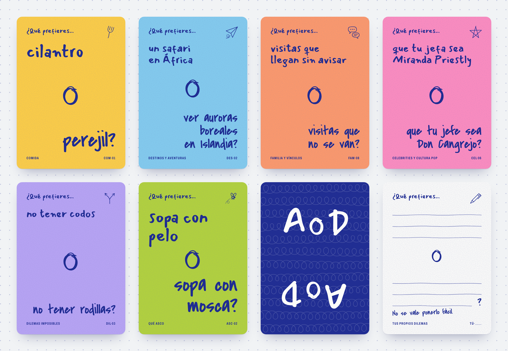

# A o D · El juego de ¿Qué prefieres?

**Jugar:** https://csaugusto.github.io/a-o-d/ (se publica solo con cada cambio en `main`).

**Retomarlo en otra conversación (por ejemplo ChatGPT):** sube `PARA-CHATGPT.md`, o mejor el zip que genera `node scripts/paquete-chatgpt.mjs` en `salida/a-o-d-para-chatgpt.zip` (documento con todo el contexto, imágenes y código).

Un juego de cartas para jugar con tu pareja, amigos o familia. Cada carta trae
dos opciones, de lo más cotidiano («¿cilantro o perejil?») a lo absurdo y a
veces asqueroso. Cada quien elige una. Sin puntos y sin ganadores: hay que
elegir.

Edición 01: 120 cartas (110 preguntas en seis categorías y 10 cartas en blanco).



## Cómo jugarlo

Abre `index.html` en el navegador. No hace falta instalar nada. Las reglas son
las mismas que en la mesa:

1. Alguien saca una carta y lee: «¿Qué prefieres…?».
2. Cada quien elige una de las dos opciones.
3. No se vale responder «las dos» ni «ninguna».
4. Explicar no es obligatorio, pero cualquiera puede preguntar «¿POR QUÉ?».
5. Siguiente carta.

Las letras a mano se cargan de Google Fonts; sin internet, el navegador usa
letras de respaldo.

## Carpetas

| Carpeta | Qué hay |
| --- | --- |
| `docs/` | Documentos del proyecto: esencia, nombre, identidad visual, impresión y la lista de cartas. |
| `js/` | `cartas.js` (todas las cartas, el nombre y el lema) y `carta.js` (dibuja cada carta). |
| `css/` | `tokens.css` (colores y tipografías) y `carta.css` (diseño de la carta). |
| `imprimir/` | Páginas para preparar las hojas y los archivos de impresión. |
| `scripts/` | Programas de Node para generar la lista de cartas, los archivos de impresión y el paquete del juego. |
| `diseno/` | Exploraciones visuales, la dirección elegida, el muestrario de cartas y capturas. |
| `salida/` | Lo que generan los scripts (archivos de impresión, juego empaquetado). No se edita a mano. |

## Cómo editar las cartas

Todas las cartas viven en un solo archivo: `js/cartas.js`.

1. Abre `js/cartas.js` en cualquier editor de texto.
2. Cambia, agrega o borra cartas. Cada carta es una línea así:

   ```js
   { id: "COM-03", a: "salsa verde", b: "salsa roja", estado: "borrador" },
   ```

   `a` y `b` son las dos opciones, sin «¿Qué prefieres» y sin punto final. El
   `id` no se reutiliza aunque borres la carta. Cuando una carta ya se probó y
   se queda, cambia su estado a `"aprobada"`.
3. Actualiza la lista legible de cartas:

   ```sh
   node scripts/listar-cartas.mjs
   ```

   Esto reescribe `docs/cartas.md` y avisa si hay códigos repetidos, opciones
   de más de 60 caracteres u opciones repetidas.
4. Abre `diseno/muestrario.html` para ver cómo quedaron. Arriba debe decir
   «Desbordes: 0».

El nombre del juego también está en `js/cartas.js`: cambiarlo es editar una
línea (ver `docs/identidad.md`).

## Cómo generar los archivos de impresión

```sh
node scripts/exportar.mjs
```

Los archivos quedan en `salida/`. Qué sale, cómo imprimir en casa y qué mandar
a la imprenta está en `imprimir/LEEME.md`. Los tamaños, proveedores y costos
están en `docs/impresion.md`.

## Cómo empaquetar el juego en un solo archivo

```sh
node scripts/empaquetar.mjs
```

Genera un solo archivo HTML con todo adentro, fácil de mandar por chat o correo.
Queda en `salida/`.

Los scripts necesitan [Node.js](https://nodejs.org) 22 o más reciente y no
instalan nada más.

## Documentos

- [`docs/esencia.md`](docs/esencia.md): qué es el juego, el tono y cómo se juega.
- [`docs/nombre.md`](docs/nombre.md): por qué «A o D» y qué falta verificar.
- [`docs/identidad.md`](docs/identidad.md): logotipo, colores, tipografías y
  anatomía de la carta.
- [`docs/impresion.md`](docs/impresion.md): formato, papel, proveedores y costos.
- [`docs/cartas.md`](docs/cartas.md): lista de todas las cartas (se genera sola).
- [`AVANCE.md`](AVANCE.md): resumen del avance para compartir.
