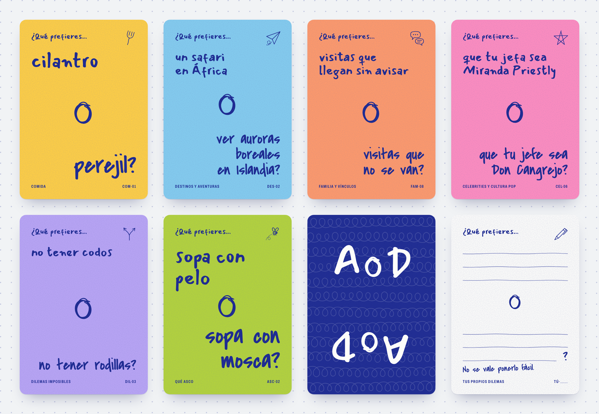
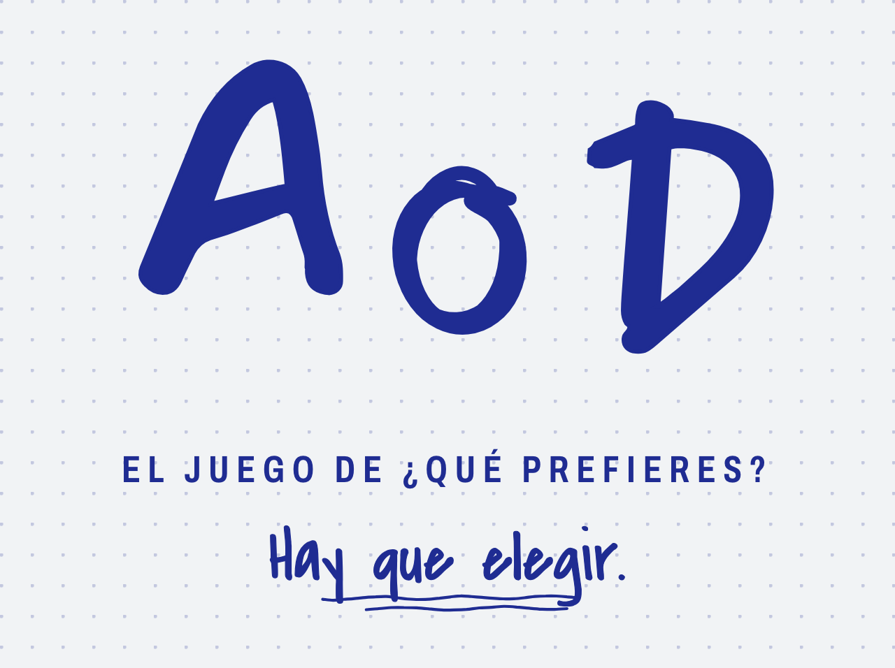
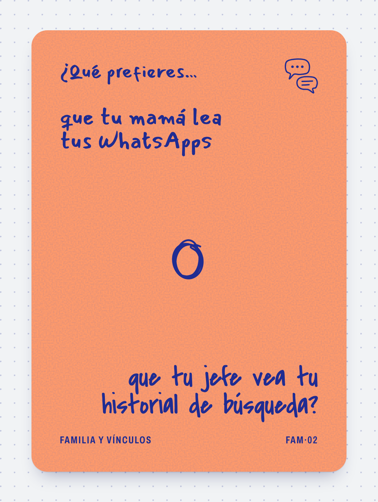

# Identidad visual

Manual corto de **A o D · El juego de ¿Qué prefieres?** Todos los valores salen
de `css/tokens.css`, `css/carta.css`, `js/carta.js` y `js/cartas.js`. Si cambias
algo en esos archivos, actualiza también este documento.



## Concepto: «Sobremesa a mano»

Una sola pluma azul que pasa de mano en mano. Una letra arranca la pregunta con
la opción A y otra letra la remata con la opción B, como cuando dos personas
inventan dilemas en la sobremesa. Cada categoría tiene su papel de color; la
tinta nunca cambia. Lo único de imprenta es el pie de la carta.

## Logotipo



El logotipo es el nombre escrito a mano: la «A» con la primera letra (Mansalva),
la «D» con la segunda (Covered By Your Grace) y, en medio, una «o» dibujada y
repasada varias veces. La «o» es la protagonista: es la misma que separa las dos
opciones en cada carta.

Hay tres versiones. Todas las dibuja `Carta.logotipo()` en `js/carta.js`; no
hay un archivo de imagen del logotipo.

| Versión | Qué lleva | Dónde se usa | Cómo se pide |
| --- | --- | --- | --- |
| **Marca** | A, «o» y D | Reverso, lugares chicos | `Carta.logotipo()` |
| **Completo** | Marca + descriptor + lema subrayado | Portada, cabecera de las páginas | `Carta.logotipo({ variante: "completo" })` |
| **Ícono** | Solo la «o», blanca sobre cuadro azul con esquinas redondeadas | Ícono de la app; se lee hasta en 16 px | `Carta.logotipo({ variante: "icono" })` |

Sobre fondo azul se usa la versión clara (letras color servilleta):
`Carta.logotipo({ claro: true })`.

### Descriptor y lema

- **Descriptor:** «El juego de ¿Qué prefieres?». Va siempre junto al nombre,
  porque «A o D» solo no explica qué es (ver `docs/nombre.md`). Se escribe en
  Archivo, mayúsculas y con letras separadas.
- **Lema:** «Hay que elegir.», a mano y subrayado. Es opcional fuera del
  logotipo completo.
- **Edición:** «Edición 01». Aparece en el pie de la portada y de las reglas.

Los cuatro textos viven en `js/cartas.js` (`nombre`, `descriptor`, `lema` y
`edicion`).

## Paleta

Una tinta, un papel por categoría. El contraste es de la tinta sobre cada papel;
todos pasan el mínimo de lectura (4.5 : 1).

| Nombre | Hex | Papel en el juego | Contraste con la tinta |
| --- | --- | --- | ---: |
| Azul pluma (`--tinta`) | `#1F2C92` | Todo lo escrito y dibujado; fondo del reverso y del ícono | |
| Servilleta (`--servilleta`) | `#FDFDFA` | Carta en blanco, dilema propio, portada, reglas; letra sobre azul | 11.2 : 1 |
| Maíz (`--papel-comida`) | `#FFCF45` | Comida | 7.8 : 1 |
| Cielo (`--papel-destinos`) | `#84CDEF` | Destinos y aventuras | 6.5 : 1 |
| Mamey (`--papel-familia`) | `#FF9A6B` | Familia y vínculos | 5.5 : 1 |
| Chicle (`--papel-celebrities`) | `#FF8DC0` | Celebrities y cultura pop | 5.4 : 1 |
| Jacaranda (`--papel-dilemas`) | `#B9A5F5` | Dilemas imposibles | 5.3 : 1 |
| Pepinillo (`--papel-asco`) | `#B4D43B` | Qué asco | 6.8 : 1 |

### La mesa

La mesa es el fondo de la aplicación y de las páginas. Es lo único que cambia
entre tema claro y oscuro; las cartas se ven igual en los dos.

| Token | Claro (mantel) | Oscuro (mantel de noche) | Para qué |
| --- | --- | --- | --- |
| `--mesa` | `#F1F3F5` | `#141838` | Fondo |
| `--mesa-texto` | `#1F2C92` | `#E8EAF8` | Texto sobre la mesa |
| `--mesa-tenue` | `#5A6297` | `#A3A9D6` | Texto secundario |
| `--mesa-linea` | `rgba(31, 44, 146, .22)` | `rgba(232, 234, 248, .2)` | Líneas y puntos de la cuadrícula |
| `--mesa-sombra` | `rgba(23, 30, 90, .38)` | `rgba(0, 0, 0, .6)` | Sombra de las cartas |

El tema sigue al sistema. Para forzarlo se pone `data-theme="light"` o
`data-theme="dark"` en la etiqueta `<html>`.

## Tipografías

Dos letras a mano y una de imprenta. Las tres son de Google Fonts con licencia
abierta (SIL Open Font License 1.1): se pueden usar, imprimir y vender en el
juego sin pagar.

| Familia | Papel | Dónde aparece | Enlace |
| --- | --- | --- | --- |
| **Mansalva** | Mano A: quien arranca | «¿Qué prefieres…», opción A, la «A» del logotipo, título y números de las reglas | <https://fonts.google.com/specimen/Mansalva> |
| **Covered By Your Grace** | Mano B: quien remata | Opción B con su «?», la «D» del logotipo, lema, texto de las reglas, «No se vale ponerlo fácil.» | <https://fonts.google.com/specimen/Covered+By+Your+Grace> |
| **Archivo** | Imprenta | Pie de la carta (categoría y código) y descriptor: mayúsculas, angosta (68 a 70 %), peso 650, letras separadas | <https://fonts.google.com/specimen/Archivo> |

Las páginas cargan las tres desde Google Fonts. Sin conexión, el navegador usa
las de respaldo definidas en `css/tokens.css` (Bradley Hand, Marker Felt, Arial
Narrow y similares), que se ven distintas.

## Anatomía de la carta

Tamaño poker, proporción 5 : 7. Todo se mide en porcentaje del ancho de la
carta, así que la misma carta sirve en pantalla y en imprenta.



### Frente

De arriba abajo:

1. **Arranque:** «¿Qué prefieres…» en la mano A.
2. **Garabato** de la categoría, arriba a la derecha: tenedor (Comida), avión de
   papel (Destinos), globos de diálogo (Familia), estrella (Celebrities),
   camino que se divide (Dilemas), mosca (Qué asco).
3. **Opción A**, alineada a la izquierda, en la mano A.
4. **La «o»** dibujada, al centro.
5. **Opción B**, alineada a la derecha, en la mano B, con el «?» final.
6. **Pie** de imprenta: categoría a la izquierda y código a la derecha. El código
   de `js/cartas.js` (`COM-01`) se imprime con punto medio: `COM·01`.

### Tamaños de letra

El programa elige uno de cuatro tamaños según lo largo del texto. No hay que
hacer nada a mano.

| Nivel | Cuándo | Letra | «o» |
| --- | --- | --- | --- |
| `t-corta` | La opción más larga tiene hasta 14 caracteres | La más grande | La más grande |
| `t-media` | La opción más larga tiene hasta 34 caracteres | Mediana | Grande |
| `t-larga` | Más de 34 caracteres | Chica | Mediana |
| `t-mini` | Solo si el texto no cabe en los otros (palabras muy largas, todo en mayúsculas) | La más chica | Chica |

Si el texto no cabe en el tamaño que le toca, el programa baja al siguiente. La
opción B va un poco más grande que la A (1.14 contra 0.95 veces el tamaño del
nivel). Máximo recomendado: 60 caracteres por opción.

### Reverso

Igual para todas las cartas, para que no delate la categoría. Fondo azul pluma
con una trama de rizos y el logotipo dos veces en color servilleta: uno derecho
y otro girado, para que se lea igual desde los dos lados de la mesa. No lleva
marcos: si el corte se mueve, no se nota.

### Carta en blanco

Es la misma carta, todavía sin tinta. Papel servilleta, garabato de pluma, tres
renglones por opción (6.6 mm entre renglones, cabe letra a mano de verdad), una
«o» más chica, la frase «No se vale ponerlo fácil.» y el pie «Tus propios
dilemas · TÚ·___» con espacio para numerarla.

### Dilema propio

Un dilema escrito por ustedes en el juego digital se dibuja como un frente
normal, pero en papel servilleta, con el garabato de pluma y el pie «Dilema
propio · TÚ».

### Portada y reglas

Son cartas extra (sobran 6 lugares al imprimir; ver `docs/impresion.md`).

- **Portada:** logotipo completo, seis papelitos con los colores de las
  categorías y el pie «Edición 01 · 110 dilemas». El número se cuenta solo a
  partir de `js/cartas.js`.
- **Reglas:** «Cómo se juega» en cinco pasos numerados con círculos a mano,
  «¿POR QUÉ?» encerrado en un óvalo y «Hay que elegir.» subrayado. Cierra con
  «Sin puntos, sin ganadores, sin reglas complicadas.» El texto está en
  `REGLAS`, dentro de `js/carta.js`.

Todas las piezas se ven juntas en `diseno/muestrario.html`, que además mide
cada carta y avisa si algo se desborda o se sale de la zona segura.

## Reglas de uso

**Sí**

- Toda la letra y los dibujos en azul pluma. En el reverso y en el ícono, al
  revés: servilleta sobre azul.
- Un papel por categoría, siempre el mismo.
- El descriptor junto al nombre cuando alguien ve el juego por primera vez (caja,
  portada, tienda, redes).
- Sobre la mesa oscura o sobre cualquier fondo azul, la versión clara del
  logotipo.
- Dejar que el programa elija el tamaño de letra.
- Revisar el muestrario después de cambiar cartas, colores o tipografías: debe
  decir «Desbordes: 0».

**No**

- No uses negro ni otro color para el texto de las cartas.
- No pongas texto con los colores de los papeles: no se lee.
- No cambies la «o» dibujada por una «o» de teclado.
- No estires, inclines ni recoloques las letras del logotipo.
- No agregues otras tipografías.
- No escribas el nombre del juego directamente en las páginas: tómalo de
  `window.MAZO.nombre`.
- No dibujes marcos ni líneas delgadas cerca del borde de la carta.
- No pongas nada importante fuera de la zona segura (5 mm del corte).

## Cómo cambiar el nombre del juego

Cambia una línea en `js/cartas.js`:

```js
nombre: "A o D",
```

Las cartas, el reverso, la portada y el logotipo lo toman de ahí. Si el nombre
nuevo tiene la forma «algo o algo» (por ejemplo «Cilantro o Perejil»), el
logotipo dibuja la «o» en medio; si no, escribe el nombre entero con la mano A.
En el mismo lugar están `descriptor`, `lema` y `edicion`.

Los documentos (`docs/` y `AVANCE.md`) mencionan el nombre en el texto; esos se
corrigen a mano.

## Cómo agregar una categoría

Ejemplo con una categoría nueva llamada «Trabajo» (`id: "trabajo"`).

1. **`js/cartas.js`:** agrega un bloque dentro de `categorias`, con `id` (en
   minúsculas, sin acentos ni espacios), `codigo` (tres letras, por ejemplo
   `TRA`), `nombre`, `descripcion`, la lista `cartas` (`TRA-01`, `TRA-02`…) y
   `banca` (puede ir vacía).
2. **`css/tokens.css`:** agrega su papel, por ejemplo
   `--papel-trabajo: #XXXXXX;`. Comprueba que la tinta `#1F2C92` tenga contraste
   de 4.5 : 1 o más sobre ese color (el más bajo hoy es 5.3 : 1).
3. **`css/carta.css`:** junto a las otras categorías, agrega
   `.carta--trabajo { --papel: var(--papel-trabajo); }`.
4. **`js/carta.js`:**
   - En `GARABATOS`, agrega `trabajo: "g-…"` con el garabato que le toca. Si es
     un dibujo nuevo, agrégalo como `<symbol id="g-…">` en `SIMBOLOS`. Sin
     garabato propio, la carta usa la pluma de las cartas en blanco.
   - La portada pinta un papelito por cada entrada de `GARABATOS` y toma su giro
     de la lista `giros` (hoy tiene seis). Agrega un giro más, por ejemplo
     `"-3deg"`.
5. Corre `node scripts/listar-cartas.mjs` para actualizar `docs/cartas.md`.
6. Abre `diseno/muestrario.html` y revisa que diga «Desbordes: 0».

## Relación con la impresión

Los detalles de formato, papel y proveedores están en `docs/impresion.md`. Lo que
toca al diseño:

- **Sangrado:** al imprimir, a la carta se le agrega la clase `carta--sangrado`.
  El papel crece 3.175 mm por lado y la parte escrita no se mueve. Las esquinas
  se dibujan rectas: las redondea la imprenta.
- **Zona segura:** todo lo escrito queda a 5 mm o más del corte. El muestrario
  lo comprueba carta por carta.
- **Ahorro de tinta** (para imprimir en casa): clase `carta--ahorro`. Fondo
  blanco sin grano de papel; el color de la categoría queda solo en una franja
  arriba, que se va al sangrado. El reverso pasa a logotipo azul sobre blanco con
  la trama apenas visible.
- Los archivos salen en RGB. Si un proveedor pide CMYK, hay que convertirlos y
  pedir una prueba de color (ver `docs/impresion.md`).
